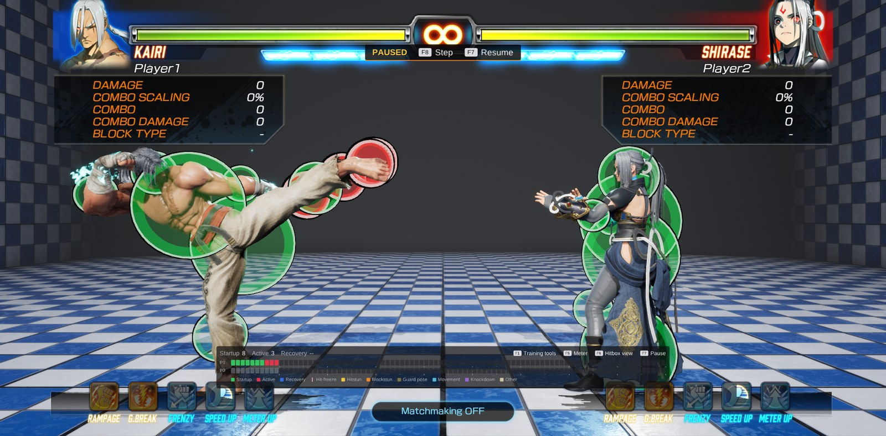
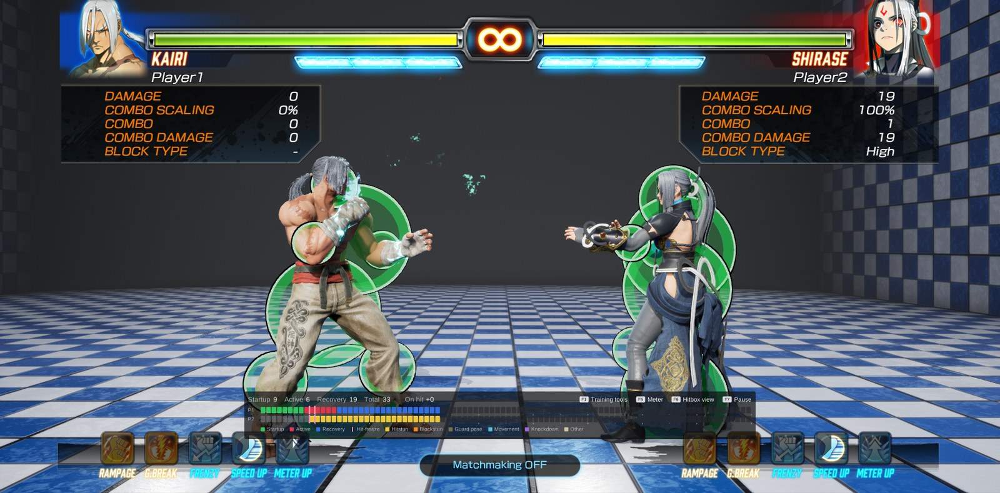
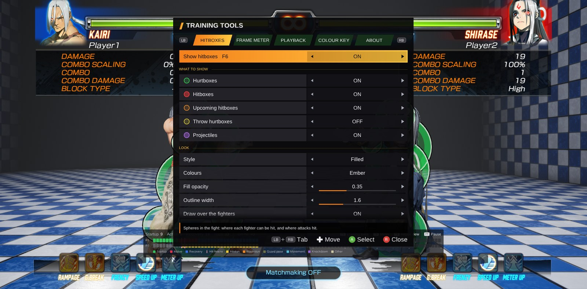
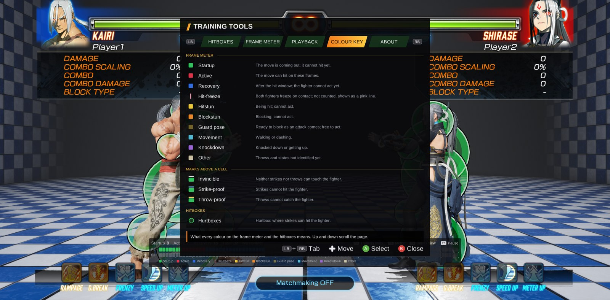
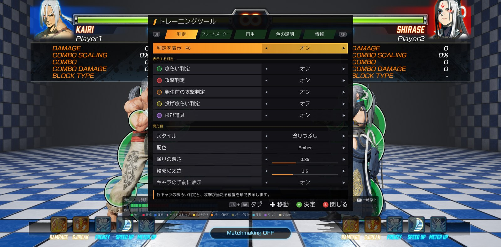

# FEXL Training Tools

A frame meter and hitbox view for **FIGHTING EX LAYER**'s Training mode (Steam).



## Features

- **Frame meter.** One cell per frame for both fighters: startup, active, recovery, total, and the frame advantage on hit or block. Hit-freeze is left out of the count, as frame data leaves it out, and marked with a pink line. Invincible frames are marked above the cells. Throws show their startup and active frame, then the throw itself and the advantage once the opponent gets up. Jumps show their take-off, air and landing frames; a jump-in reads its attack and the advantage after landing. The Gougi Hunting Dash and EX Arrow read as jumps, and Teleport shows its total. Size and opacity can be set in the menu.
- **Hitbox view.** The game's own hit spheres, drawn in the 3D scene: hurtboxes, active hitboxes, hitboxes about to come out, throw hurtboxes and projectiles. Hurtboxes that cannot be hit right now turn grey. Filled, outline or wireframe, in three palettes (one colour-blind safe).
- **Pause, frame step and slow motion** (half and quarter speed) for the fight, while the camera and menus keep running.
- **A menu in the game's own style** (F1), driven by pad, keyboard or mouse, with a colour key that explains everything on screen.
- **English and Japanese** (follows the Windows display language, or choose in the menu).

It works in Training mode only. In every other mode, and online, it draws nothing, takes no input and changes nothing.

| | |
|---|---|
|  |  |
|  |  |

## Install

1. Get `dinput8.dll` from the Releases page (or build it, below) and put it next to the game's executable:
   `steamapps\common\FIGHTING EX LAYER\EXF\Binaries\Win64\` (beside `EXF-Win64-Shipping.exe`).
2. On Linux or Steam Deck (Proton), also set the game's launch options to
   `WINEDLLOVERRIDES="dinput8=n,b" %command%`.
3. Start the game and go to Training. The meter appears above the Gougi icons; press **F1** for the menu.

To remove it, delete `dinput8.dll`. Settings are kept in `fexl_trainer.ini` beside it, and a short log in `fexl_trainer.log`.

## Controls

| Key | |
|---|---|
| F1 | Training Tools menu |
| F5 | Frame meter on or off |
| F6 | Hitboxes on or off |
| F7 | Pause or resume the fight |
| F8 | Step one frame while paused |

In the menu: **LB / RB** (or Q / E) change tab, the **d-pad** (or arrow keys) moves and changes values, **A** (Enter) selects, **B** (Esc) closes. While the menu is open the pad belongs to the menu, not the fight.

## Reading the meter

Each cell is one frame (1/60 s). A bar starts when either fighter commits and ends when both are free again. The line above the bars reads out the move: `Startup 9  Active 6  Recovery 19  Total 33  On hit +0`. The advantage is the attacker's: **+** means the attacker acts first, **−** the defender. A chain, a cancel or a special's follow-up stage counts as one move, so the advantage is read from the end of the whole string. The Colour key tab in the menu explains every colour.

## Compatibility and safety

- Made for the Steam version **1.6.0** (build 26967029). On any other version the mod stays off and says so in its log.
- The game ships no anti-cheat. Even so, the mod checks the game's own mode on every frame and does nothing outside Training.
- It never changes the fight itself. In Training it draws over it, and holds or slows it only when you ask.
- On a scaled display (for example 150 %), the game is shown at the screen's real resolution, so its resolution list is no longer capped.

## Frame data accuracy

The meter was checked against the community frame data sheet: Kairi's standing and crouching normals all match its startup, total and advantage on hit. On block, two moves read differently from that sheet (standing HP −1 against −2, standing MK −7 against −15). The game puts the defender in blockstun for longer than the sheet lists, which was made several patches ago. The meter reports what the game does.

## Building

```sh
FEXL_DEPS=/path/to/deps ./build.sh
```

`FEXL_DEPS` is an x64-windows build of [Dear ImGui](https://github.com/ocornut/imgui) (with its Win32 and DirectX 11 backends) and [MinHook](https://github.com/TsudaKageyu/minhook): `include/` and `lib/` with `imgui.lib` and `minhook.x64.lib`. A vcpkg `x64-windows` tree works. `CLANG_CL` and `LLD_LINK` choose the compiler and linker (`clang-cl` and `lld-link` on PATH by default). On Linux, cross-building also needs the Windows SDK and MSVC libraries, for example via [xwin](https://github.com/Jake-Shadle/xwin). The DLL is written to `build/dinput8.dll`.

## License

MIT. FIGHTING EX LAYER is a trademark of ARIKA Co., Ltd. This project is not affiliated with ARIKA.
